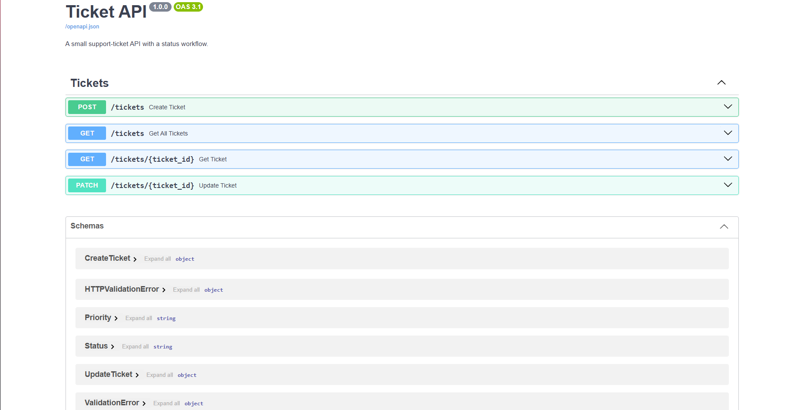

# Ticket API

A small support-ticket REST API, like the back end of an IT helpdesk. Tickets are created, filtered, and moved through a fixed workflow, with rules that stop invalid changes.

Built with **FastAPI**, **SQLModel** (SQLAlchemy + Pydantic) and **SQLite**, and tested with **pytest**.



## Features

- Create, fetch and list tickets
- Filter the list by status and/or priority
- Update a ticket's status and priority with a single `PATCH` (only the fields you send are changed)
- A status workflow that rejects invalid moves with a clear error message
- Input validation (missing fields, unknown status or priority values and explicit `null` values are rejected)
- 18 automated tests that run against a throwaway in-memory database

## Status workflow

A ticket starts as `open`. Moves are only allowed along this path:

| From | Allowed next status |
|---|---|
| `open` | `in_progress` |
| `in_progress` | `closed` |
| `closed` | none (a closed ticket is final; open a new ticket instead) |

Any other move, including sending the status a ticket already has, returns `409 Conflict` with a message naming the move and the allowed options. A rejected request changes nothing, including any priority sent in the same request.

## Endpoints

| Method | Path | What it does |
|---|---|---|
| `POST` | `/tickets` | Create a ticket from a `title` and `description`. It starts as `open` with `medium` priority. |
| `GET` | `/tickets` | List tickets. Optional filters: `?status=open`, `?priority=high`, or both together. |
| `GET` | `/tickets/{ticket_id}` | Fetch one ticket. |
| `PATCH` | `/tickets/{ticket_id}` | Change `status` and/or `priority`. Both fields are optional. |

**Ticket fields:** `id`, `title`, `description`, `priority` (`low`, `medium`, `high`), `status` (`open`, `in_progress`, `closed`), `created_at` (UTC).

**Error responses**

| Code | When |
|---|---|
| `404` | The ticket does not exist |
| `409` | The status change is not allowed from the ticket's current status |
| `422` | The request is invalid (missing field, unknown value, or `null` for status or priority) |

## Getting started

Requires **Python 3.11 or newer** (developed on 3.14).

```bash
git clone <https://github.com/jaydenbau-cmd/ticket-api.git>
cd ticket-api

python -m venv .venv
# Windows (PowerShell):
.venv\Scripts\activate
# macOS / Linux:
# source .venv/bin/activate

pip install -r requirements.txt
fastapi dev main.py
```

Then open <http://127.0.0.1:8000/docs> for the interactive API page, where every endpoint can be tried from the browser.

The SQLite database (`tickets.db`) is created automatically on first start and is not committed to the repository.

## Running the tests

```bash
pytest -v
```

The tests use an in-memory SQLite database that is rebuilt for every test, so they never touch your real data. They cover creating, fetching and listing tickets, both filters and their combination, every status rule, partial updates, and invalid or missing input.

## Project structure

```
main.py            API routes, status rules, database session setup
models.py          Ticket table and the Status / Priority enums
test_main.py       pytest test suite
requirements.txt   Dependencies
```

## Design notes

- **`PATCH` for updates.** Staff change part of a ticket, so only the fields in the request are applied. A validator rejects an explicit `null`, since the database columns cannot be empty.
- **Rules in one dictionary.** The allowed status moves are stored in a single dictionary, so changing the workflow (for example, allowing an in-progress ticket to return to open) is a one-line change.
- **Separate input and table models.** Clients can only send a title and description when creating a ticket. The `id`, status, priority and timestamp are set by the server.
- **Session dependency.** Each request gets its own database session through FastAPI's dependency system, which is also how the tests swap in a temporary database.

## Known limitations and next steps

- **No authentication.** The original idea was that any support agent can move a ticket to `in_progress`, but only a manager can close it. Enforcing that needs login and roles, which are not built yet.
- **No database migrations.** Tables are created at startup but never altered. After changing a model, delete `tickets.db` so it is rebuilt. A migration tool such as Alembic would fix this.
- **Comments on tickets**, **pagination** on the list, and **PostgreSQL** support (SQLModel is built on SQLAlchemy, so this is mostly a change to the connection URL) are possible additions.

- ## Built with / learned from

- [FastAPI](https://fastapi.tiangolo.com/)
- [SQLModel](https://sqlmodel.tiangolo.com/)
